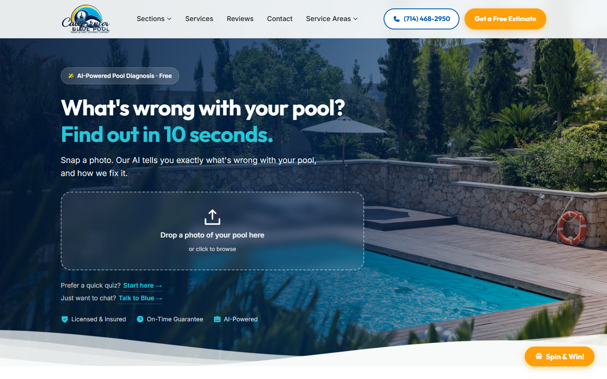
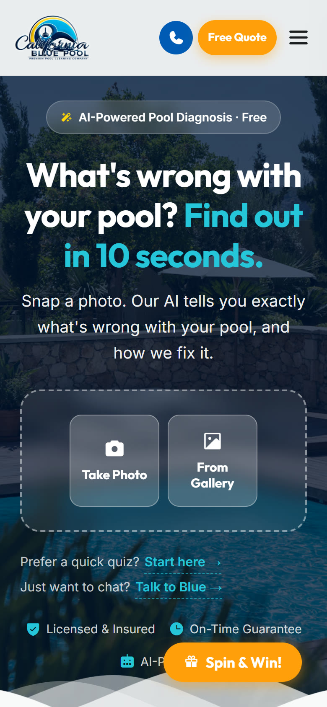
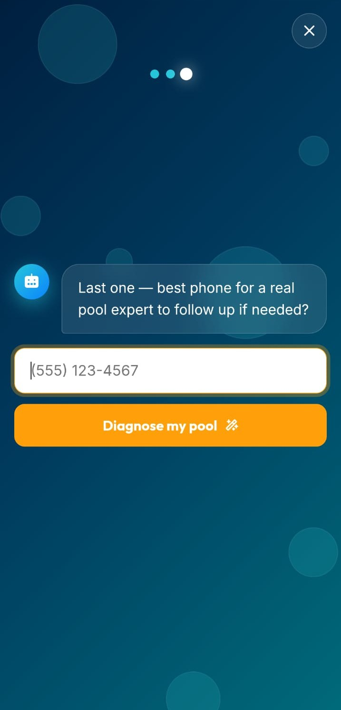
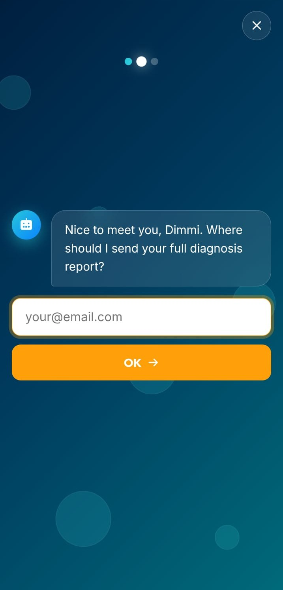
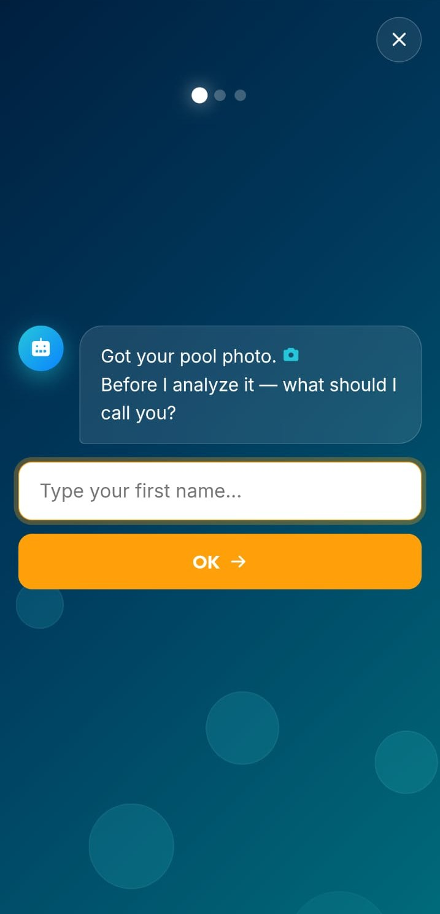
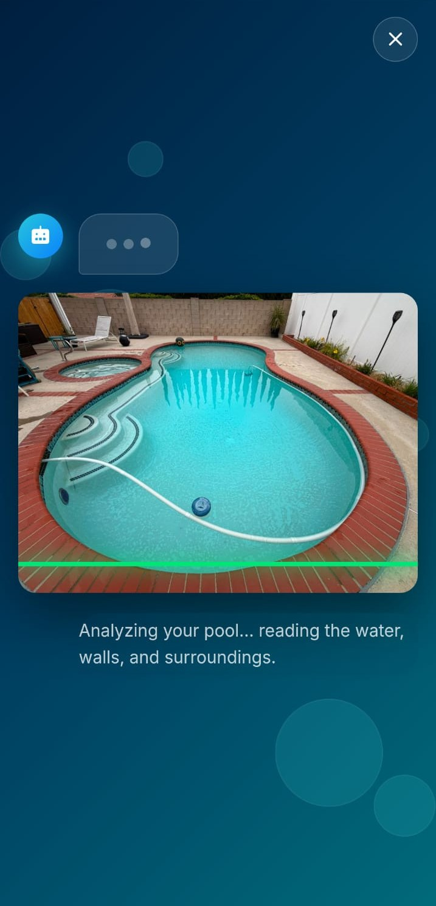
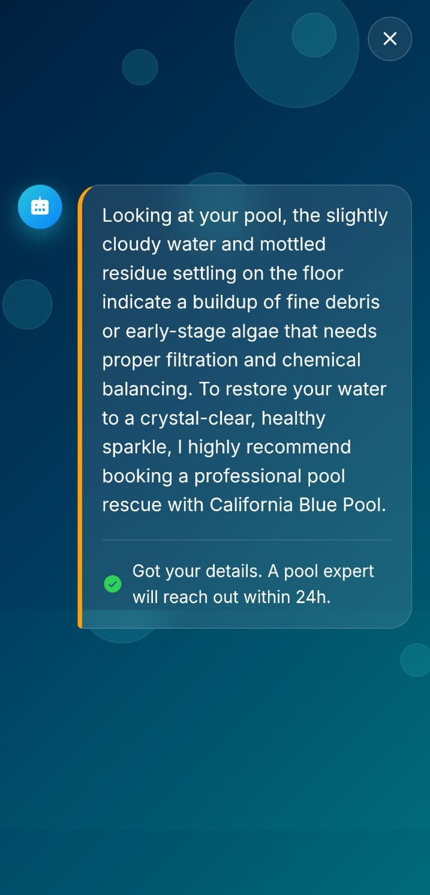
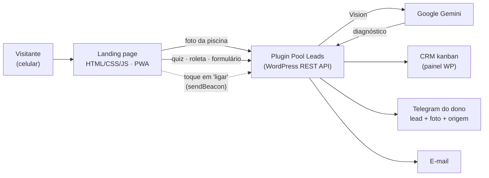

# California Blue Pool: captação de clientes com IA

> **Cliente:** California Blue Pool, empresa de limpeza, manutenção e reparos de piscinas residenciais em Irvine, Califórnia (EUA), atendendo 19 cidades de Orange County.
> **Entrega:** [AtosSofts](https://atossofts.com.br) · **Site:** [californiabluepool.com](https://californiabluepool.com)
> **Código:** privado (propriedade do cliente). Este repositório mostra só a arquitetura e as funcionalidades.

---

  

---

## O problema

Empresas de serviço gastam com anúncio, recebem visita no site e **perdem o cliente nos minutos seguintes**: o formulário cai num e-mail que ninguém olha, ninguém sabe de onde o lead veio, e o dono só descobre o problema da piscina quando chega lá.

## A solução

Uma landing page rápida, com um backend sob medida em WordPress, em que **cada visitante sai com um diagnóstico e o dono recebe um lead qualificado no celular em segundos.**

### 🤖 AI Pool Doctor
O visitante tira uma foto da piscina e a IA (**Google Gemini Vision**) devolve, em até 3 frases, o provável problema (algas, água turva, sujeira...) e a recomendação de agendar o serviço. A foto e o diagnóstico ficam **anexados ao lead**, então quem liga para o cliente já sabe o que vai encontrar.

Enquanto a IA analisa a foto, uma conversa curta pede nome, e-mail e telefone: o visitante recebe o diagnóstico e o dono recebe o lead completo.

  
  
  
  
  

Fluxo real no celular, com foto de uma piscina de verdade. O diagnóstico final é a resposta do Gemini, sem edição.

### 📲 Lead no celular na hora
Cada lead chega no **Telegram** do dono com nome, telefone e e-mail prontos para copiar, a origem do contato e **a foto da piscina**. Se o Telegram falhar, o sistema tenta de novo e o lead vai para um painel de "não notificados". **Nenhum lead se perde em silêncio.**

### 🗂️ CRM em kanban
Os leads entram num funil visual: *Novo → Contatado → Orçamento enviado → Agendado → Ganho / Perdido*.

### 🎯 Várias portas de entrada
- **Quiz** que identifica a necessidade do visitante
- **Roleta de oferta** que converte quem ia sair sem deixar contato
- **Diagnóstico por foto** com IA
- **Rastreamento de toques no telefone**: cada clique em "ligar" é registrado com dispositivo, posição na página e origem do tráfego, sem atrasar a ligação
- **Atribuição de origem** em todo lead (Google, Meta, direto...)

### 🛡️ Robustez
Proteções anti-bot (honeypot, armadilha de tempo, limite por IP), limite de uso da IA, fotos guardadas com nomes impossíveis de adivinhar, lead **salvo antes do envio de e-mail** (se o SMTP cair, nada se perde), plugin traduzido para inglês e português, e `llms.txt` para a empresa ser bem descrita por buscadores com IA.

---

## Arquitetura

## Stack

`HTML` `CSS` `JavaScript` `PWA` · `WordPress` `PHP` (plugin sob medida, API REST) · `Google Gemini Vision` · `Telegram Bot API` · `i18n en/pt-BR`

## Resultados

<!-- {{preencher com números reais autorizados pelo cliente, ex.: leads por mês, tempo até o primeiro contato, % de leads com foto}} -->
*Em breve.*

---

**Quer algo assim no seu negócio?** → [WhatsApp](https://wa.me/5587996032135?text=Ol%C3%A1%20Dimmi%2C%20vi%20seu%20GitHub%20e%20quero%20conversar%20sobre%20um%20projeto.) · [contato@atossofts.com.br](mailto:contato@atossofts.com.br) · [atossofts.com.br](https://atossofts.com.br) · [LinkedIn](https://www.linkedin.com/in/dimmisueg/)

🇺🇸 Lead-generation landing page for a pool service company in Orange County, CA. AI photo diagnosis (Gemini Vision), instant Telegram alerts with the photo, kanban CRM, call-tap tracking and traffic attribution. Client code is private.
